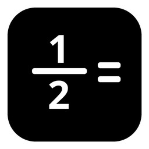

# Math Practice

**Learn and practise basic math**

  

[**Download**](https://github.com/PrimitiveOS/kindle-primitive-math-practice/releases/latest) · [**Install guide**](INSTALL.md) · [**Changelog**](CHANGELOG.md)

---

Start with a worked example and practise arithmetic, fractions, or percentages in five-question sessions. Use a large keypad, check equivalent answers, and retry misses. Your skill history stays on your Kindle.

## Quick start

After setting up PrimitiveOS, open **Store** from Primitive Launcher. Choose **Math Practice** under **Apps**,
tap **Get**, and open it from the Launcher grid. The [install guide](INSTALL.md) also covers the standalone USB package.

## Highlights

- Start with a worked example and practise arithmetic, fractions, or percentages in five-question sessions.
- Use a large keypad, check equivalent answers, and retry misses.
- Your skill history stays on your Kindle.

## Status

| Device | Status |
|---|---|
| Kindle Oasis 3 (1264 × 1680, firmware 5.18.2) | Tested on hardware |

**Current version: 0.1.1.** Changes are in [CHANGELOG.md](CHANGELOG.md).

## Downloads

**21 downloads** from Store, as of 2026-11-21. Store shows the same count on the app page.
The count is GitHub downloads of this app's release packages, from the [Store catalog](https://primitiveos.github.io/kindle-primitive-catalog/v1/index.json).

## Documentation

[Install guide](INSTALL.md) · [Changelog](CHANGELOG.md)

## Licence

Copyright (C) 2026 Doan Nguyen.

The code uses the [PolyForm Noncommercial License 1.0.0](LICENSE).
Project-owned documentation, artwork, screenshots, and original exercise content use [CC BY-NC-SA 4.0](LICENSE-DOCS).
