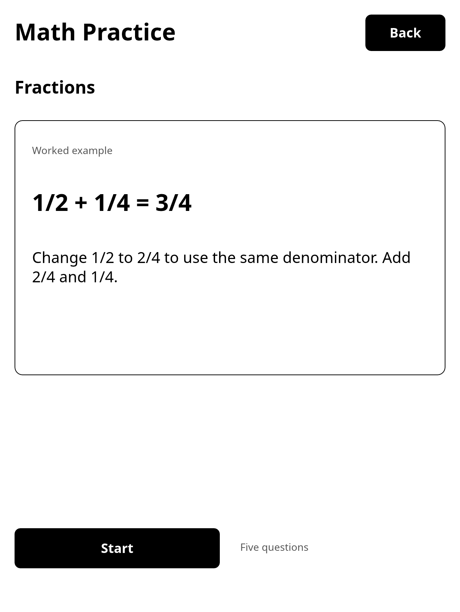
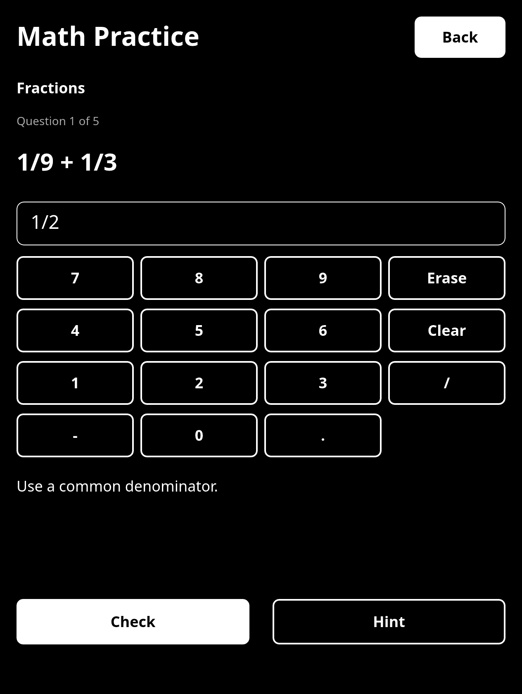

# Math Practice

Math Practice puts a worked example and five short questions on separate Kindle pages. It includes arithmetic, fractions, and percentages.

- Choose a skill, read the example, then tap **Start**.
- Use the large keypad for whole numbers, decimals, or fractions such as 2/4. Equivalent values are accepted.
- Use **Hint** when useful, then **Check** to see the reasoning. **Next** takes you to the next question.
- After the set, choose **Retry missed** or **New set**.

Questions are generated offline. The current set, answer draft, and skill history are saved on Kindle.

<table>
  <tr>
    <td></td>
    <td></td>
  </tr>
</table>

The screenshots come from the desktop simulation.

## Install

Find **Math Practice** in PrimitiveOS Store. [Local build and packaging instructions](INSTALL.md)

## Test locally

```sh
cargo test --offline --locked --workspace
cargo run --offline --locked -p math-practice-desktop -- build/previews
```

See `docs/images/` for captured screens. The simulation uses the Launcher fonts from a sibling checkout.

## Licence

Copyright (C) 2026 Doan Nguyen.

The code uses the [PolyForm Noncommercial License 1.0.0](LICENSE).
Project-owned documentation, artwork, screenshots, and original exercise content use [CC BY-NC-SA 4.0](LICENSE-DOCS).
